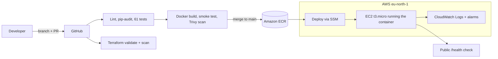

# Tips Splitter

[](https://github.com/carinabbusi/tips-splitter/actions/workflows/ci.yml)

A small API that splits a team's tips fairly, to the cent, with a full DevOps toolchain around it: automated tests, a GitHub Actions CI/CD pipeline, Docker, and AWS infrastructure defined as code with Terraform.

> Built for the **DevOps na Prática** course (Systems Analysis and Development, PUCRS Online), Phase 1: CI and Infrastructure as Code. Phase 2: Continuous Delivery, containers, monitoring and security.

## The problem

Every month I split the tips for my team at work by hand. Each day's tips are shared equally among the people who worked that day, and at the end of the month everyone needs to know how much they get, plus a day by day breakdown. Done by hand, it is slow and easy to get wrong, especially with cents that don't divide evenly.

## What it does

- Splits each day's tips equally among that day's workers
- Works in integer cents, so **the shares always add up exactly** to what was collected. Leftover cents (e.g. €10.00 / 3) go one at a time in alphabetical order, so results are fair and repeatable
- Normalises names (`"  bia "` and `"BIA"` are the same person)
- Returns the total per person, days worked and a per-day breakdown
- Available as an **HTTP API** (FastAPI) and as a **command line tool** that reads a CSV

```bash
$ python -m tips_splitter.cli data/sample_tips.csv
Total collected: EUR 341.80

Person           Days    To receive
Alex                6     EUR 82.06
Bia                 6     EUR 84.53
Caio                6     EUR 61.25
Duda                5     EUR 58.76
Enzo                4     EUR 55.20
```

The sample data is fictional.

## Architecture



| Layer | Tool |
|---|---|
| Application | Python 3.12, FastAPI |
| Tests | pytest, pytest-cov (61 tests, ~99% coverage) |
| Code quality | Ruff (lint + formatting) |
| CI/CD | GitHub Actions (OIDC to AWS, no stored keys) |
| Containers | Docker (non-root image with healthcheck) |
| Security | pip-audit, Trivy (image + Terraform), Dependabot, protected main |
| Infrastructure as Code | Terraform, AWS provider |
| Cloud | AWS: ECR, EC2, IAM, SSM, Security Group, CloudWatch Logs + alarms, SNS |
| Dependency updates | Dependabot (pip, Actions, Terraform) |

## Run locally

```bash
python -m venv .venv
source .venv/bin/activate          # Windows: .venv\Scripts\activate
pip install -r requirements-dev.txt

pytest                             # tests + coverage report
uvicorn tips_splitter.main:app --reload
```

Open http://127.0.0.1:8000/docs to try the API in the browser.

Example request:

```bash
curl -X POST http://127.0.0.1:8000/split \
  -H "Content-Type: application/json" \
  -d '{"entries":[{"date":"2026-09-01","amount":"10.00","workers":["Alex","Bia","Caio"]}]}'
```

## CI/CD pipeline

`.github/workflows/ci.yml` runs on every pull request and push to `main` (which is protected: changes only land through a PR with green checks).

| Job | What it does | Runs on |
|---|---|---|
| Lint and tests | Ruff, pip-audit, pytest (fails under 90% coverage), API smoke test, test reports as artifacts | every PR and push |
| Terraform | fmt, validate, Trivy config scan | every PR and push |
| Docker image | build, run the container and call `/health`, Trivy image scan (fails on critical), push to ECR | build/scan always, push only on `main` |
| Deploy | runs `deploy.sh` on the EC2 server through SSM, then checks the public `/health` | only on `main` |

GitHub Actions authenticates to AWS with **OIDC**: no AWS keys are stored in GitHub, and the role only accepts the `main` branch of this repo.

Repository variables used by the pipeline (Settings > Secrets and variables > Actions > Variables): `AWS_ROLE_ARN`, `AWS_REGION`, `ECR_REPOSITORY`, `INSTANCE_ID`, `APP_URL`. All come from `terraform output`.

## Run with Docker

```bash
docker build -t tips-splitter .
docker run -p 8000:8000 tips-splitter
curl http://127.0.0.1:8000/health
```

## Infrastructure (Terraform)

`infra/terraform` describes the staging environment in AWS Stockholm (`eu-north-1`):

- **ECR** repository with scan on push and a lifecycle policy (keeps the last 5 images)
- **EC2** `t3.micro` running Amazon Linux 2023 with Docker, IMDSv2 required and encrypted disk
- **IAM** role with only what the server needs (pull images, SSM access, send logs)
- **Security Group** allowing HTTP only. No SSH: the server is managed through AWS Systems Manager
- **CloudWatch Logs** group with 7 day retention for the app's JSON logs
- **CloudWatch alarms** for 5xx errors (metric filter on the JSON logs) and EC2 status checks, sent to an **SNS** topic (optional email)
- **OIDC role** for GitHub Actions, limited to pushing to this ECR repo and running the deploy command

```bash
cd infra/terraform
terraform init
terraform plan
terraform apply      # creates resources in your AWS account
terraform destroy    # remove everything when you're done, to avoid charges
```

## Roadmap

- [x] Dockerfile and image published to ECR
- [x] Continuous Delivery: deploy to EC2 automatically after CI passes
- [x] Security scanning (dependencies, container image, Terraform)
- [x] Monitoring: CloudWatch logs and alarms
- [ ] Remote Terraform state in S3 with locking
- [ ] HTTPS with a domain and a load balancer
- [ ] Monthly PDF report and historical metrics per person and weekday

## Project structure

```
tips_splitter/      application code (rules, API, CLI, CSV loader)
tests/              automated tests
data/               fictional sample data
infra/terraform/    infrastructure as code (AWS)
Dockerfile          container image
.github/            CI/CD workflow and Dependabot
```
