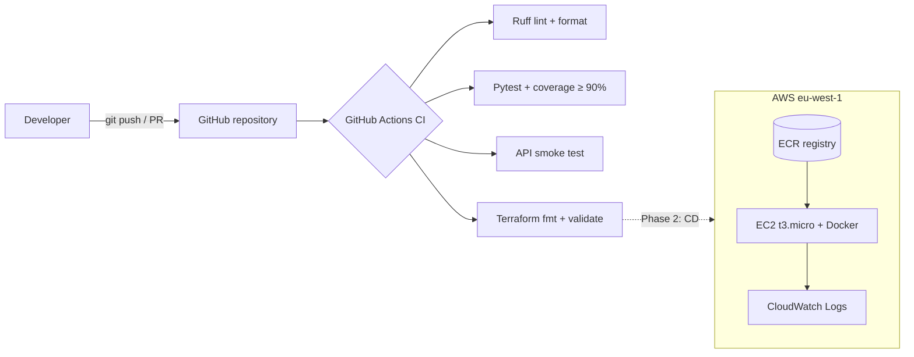

# Tips Splitter

[](https://github.com/carinabbusi/tips-splitter/actions/workflows/ci.yml)

A small API that splits a team's tips fairly, to the cent, with a full DevOps toolchain around it: automated tests, a GitHub Actions CI pipeline and AWS infrastructure defined as code with Terraform.

> Built for the **DevOps na Prática** course (Systems Analysis and Development, PUCRS Online), Phase 1: CI and Infrastructure as Code.

## The problem

Every month I split the tips for my team at work by hand. Each day's tips are shared equally among the people who worked that day, and at the end of the month everyone needs to know how much they get, plus a day by day breakdown. Done by hand, it is slow and easy to get wrong, especially with cents that don't divide evenly.

## What it does

- Splits each day's tips equally among that day's workers
- Works in integer cents, so **the shares always add up exactly** to what was collected. Leftover cents (e.g. €10.00 / 3) go one at a time in alphabetical order, so results are fair and repeatable
- Normalises names (`"  bia "` and `"BIA"` are the same person)
- Returns the total per person, days worked and a per-day breakdown
- Available as an **HTTP API** (FastAPI) and as a **command line tool** that reads a CSV

```bash
$ python -m tips_splitter.cli data/sample_tips.csv
Total collected: EUR 341.80

Person           Days    To receive
Alex                6     EUR 82.06
Bia                 6     EUR 84.53
Caio                6     EUR 61.25
Duda                5     EUR 58.76
Enzo                4     EUR 55.20
```

The sample data is fictional.

## Architecture



| Layer | Tool |
|---|---|
| Application | Python 3.12, FastAPI |
| Tests | pytest, pytest-cov (61 tests, ~99% coverage) |
| Code quality | Ruff (lint + formatting) |
| CI | GitHub Actions |
| Infrastructure as Code | Terraform, AWS provider |
| Cloud | AWS: ECR, EC2, IAM, Security Group, CloudWatch Logs |
| Dependency updates | Dependabot (pip, Actions, Terraform) |

## Run locally

```bash
python -m venv .venv
source .venv/bin/activate          # Windows: .venv\Scripts\activate
pip install -r requirements-dev.txt

pytest                             # tests + coverage report
uvicorn tips_splitter.main:app --reload
```

Open http://127.0.0.1:8000/docs to try the API in the browser.

Example request:

```bash
curl -X POST http://127.0.0.1:8000/split \
  -H "Content-Type: application/json" \
  -d '{"entries":[{"date":"2026-09-01","amount":"10.00","workers":["Alex","Bia","Caio"]}]}'
```

## CI pipeline

`.github/workflows/ci.yml` runs on every push and pull request to `main`:

1. **Lint and tests**: installs dependencies, runs Ruff, runs pytest (fails under 90% coverage), starts the API and calls `/health`, uploads JUnit and coverage reports as artifacts.
2. **Terraform**: checks formatting and validates the configuration. No AWS credentials are needed for this step.

## Infrastructure (Terraform)

`infra/terraform` describes the staging environment in AWS Ireland (`eu-west-1`):

- **ECR** repository with scan on push and a lifecycle policy (keeps the last 5 images)
- **EC2** `t3.micro` running Amazon Linux 2023 with Docker, IMDSv2 required and encrypted disk
- **IAM** role with only what the server needs (pull images, SSM access, send logs)
- **Security Group** allowing HTTP only. No SSH: the server is managed through AWS Systems Manager
- **CloudWatch Logs** group with 7 day retention for the app's JSON logs

```bash
cd infra/terraform
terraform init
terraform plan
terraform apply      # creates resources in your AWS account
terraform destroy    # remove everything when you're done, to avoid charges
```

## Roadmap (Phase 2)

- [ ] Dockerfile and image published to ECR
- [ ] Continuous Delivery: deploy to EC2 automatically after CI passes
- [ ] Remote Terraform state in S3
- [ ] Security scanning (dependencies, container image, Terraform)
- [ ] Monthly PDF report and historical metrics per person and weekday

## Project structure

```
tips_splitter/      application code (rules, API, CLI, CSV loader)
tests/              automated tests
data/               fictional sample data
infra/terraform/    infrastructure as code (AWS)
.github/            CI workflow and Dependabot
```
